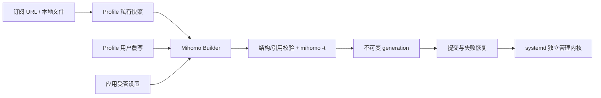

# Profile 与运行配置设计

状态：2026-10-30，当前支持 Linux / systemd 用户服务 / Mihomo。源码调研及方案比较见 [调研记录](subscription-research.md)，实际验证范围见 [验证记录](subscription-verification.md)。当前实现以本文为准。

## 产品模型

用户只管理 Profile：从订阅 URL 下载，或导入本地完整配置；每个 Profile 自己保存名称、下载地址、更新时间、内容版本和用户覆写。没有独立的 Sources 列表、来源 ID、共享引用关系或 `subscription` CLI。

当前只支持完整 Mihomo 配置。不实现独立节点来源、多订阅抽取组合、Managed 配方、模板创建或脚本执行。多个完整配置具有各自的组名、引用和规则顺序，不能通过通用 YAML 合并得到可靠结果。后续确有组合需求时再设计用户行为和配置语义，不预先保留管理接口或抽象。

| 概念 | 职责 |
| --- | --- |
| Profile | 稳定 ID、显示名称及命名来源、可选私密地址、更新时间、内容 revision、覆写与校验记录 |
| Application Settings | 应用受管端口、控制密钥及显式 mode；运行意图和界面偏好另存 |
| Runtime Configuration | 经 Builder 和内核验证的完整 YAML，连同固定构建输入组成不可变 generation |
| Core Runtime State | 真实 systemd/PID/API 状态；与用户期望运行状态分别记录 |

原始配置与用户覆写仍然分开，避免下载更新覆盖手工规则。订阅 URL 是 Profile 的属性。同一 URL 导入两次得到两个独立 Profile；刷新、改地址或删除其中一个，不影响另一个。



## 存储与身份

```text
HOME/
  configuration/
    library.json                 # v3：单一 profiles 索引
    snapshots/<sha256>.yaml      # 原文私有快照，只新增、内容寻址
  installation/
    mihomo
    generations/g-<id>/
      config.yaml                # 最终运行配置
      manifest.json              # 设置、Profile ID、revision、覆写及文件摘要
    current -> generations/g-<id>
    runtime/                     # 稳定 Mihomo -d：选择缓存、Provider 缓存、本地资产
  apply-pending.json             # 带两代 guard 的未完成配置事务
  runtime-state.json             # 用户运行意图与操作状态
  stop-intent.json               # Stop 优先记录
  preferences.json
```

`configuration.Profile` 仅保存 `core`、`revision`、`overrides`，作为运行构建依据。`ProfileRecord` 在其外保存 `name`、`name_source`、`name_base`、可选 `address`、`updated_at`、`validated`。地址和名称不进入运行配置或构建指纹，改名不会产生 Pending 或重新生成配置。

快照先写，Profile 索引后原子提交；中断最多留下未引用私密快照，不会发布一半的新名称、地址或内容。CLI/TUI 共用应用锁，CAS 拒绝覆盖外部修改。库只接受当前完整结构，不迁移或补齐开发期旧数据；损坏文件明确报错保留。

Profile ID、显示名称、服务端文件名和磁盘路径分离。ID 稳定；原文始终使用内容摘要寻址，运行文件位于 generation 的 `config.yaml`，服务端文件名不会作为路径。

运行代固定当时的 revision 与覆写。下载刷新、改地址和编辑覆写只保存草稿，Start/Restart 使用已提交代；网站不可用也不重新下载。改端口和 mode 继续使用已应用配置，不意外采用新草稿。

删除 Profile 一次移除其名称、地址和当前内容引用，不留下独立来源记录或后续下载任务。旧 generation 和快照暂不自动回收，以保留恢复依据；GC 需另行考虑当前代、恢复日志和历史代。历史原文仍是敏感数据。

## 订阅显示名称

一次下载同时获得配置原文与 HTTP 响应头，不为名称额外请求。解析、清理和去重集中在 `configuration/names.go`，与 Mihomo 配置语义无关。

首次导入优先级：用户明确指定 → `profile-title` → `Content-Disposition` 的 `filename*` → `filename` → URL 最后一段有效路径 → Host → `Remote Subscription`。

支持 UTF-8、`base64:` 标题、RFC 5987 文件名及传统 `filename`。无效或空白头部继续回退，不使有效下载失败。URL 忽略查询与 Fragment，处理百分号编码、末尾斜杠，可移除 `.yaml` / `.yml`。文件名只取末段；显示文本清除 ANSI、控制和方向字符，折叠空白、NFC 规范化，限制到 128 个 Unicode 码点。

名称来源为 `custom` / `provider` / `url` / `fallback`；`name_base` 保存去重前候选。比较时统一空白、NFC 和 Unicode case fold，与其他 Profile 或内建 `default` 重复时添加 ` (1)`、` (2)`。刷新从新候选重新计算，不累加旧后缀；删除其他 Profile 不主动整理名称。

| 操作 | 名称行为 |
| --- | --- |
| URL Add / Import | 自动解析，不弹名称表单 |
| CLI --name / Rename | 标记 custom，刷新保护用户名称 |
| 刷新有有效名称头 | 非 custom 名称同步，可由 URL/fallback 升级为 provider |
| 刷新缺失或无效名称头 | 保留原名称及来源 |
| Edit URL | 自动名称按新响应/URL 重算，custom 保留 |
| 下载或校验失败 | 不发布候选名称、地址或 revision |

TUI 用 ID 绑定卡片、详情和动作，用名称显示。CLI 优先解析精确 ID，其次解析唯一显示名称；脚本使用列表返回的 `id`。

## 构建语义

顺序：单一 YAML mapping → Profile 覆写 → 容器/命名检查 → Provider 缓存隔离 → 引用检查 → 应用受管字段 → 显式全局 mode → 当前 Mihomo `-t`。

| 字段 | 处理方式 |
| --- | --- |
| 基础配置 | 保留节点、组、规则、providers、hosts、DNS 和未知原生字段；拒绝明显错误响应或 sing-box 配置 |
| overrides.set | 顶层字段整体替换，map/list 不 Deep Merge，不按 name 静默合并 |
| prepend-rules | 前插并保留顺序、重复项 |
| append-rules | 后插；已有可确定终止的 MATCH,DIRECT/REJECT/REJECT-DROP 时拒绝 |
| 节点/组 | 拒绝重复或保留名称，检查组、use、dialer-proxy 引用和显式循环 |
| 规则 | 检查简单目标和 RULE-SET 引用；复杂表达式由 Mihomo 解释，不排序去重 |
| HTTP Provider | 按类别、名称及完整定义摘要隔离缓存，URL/header 改变不会串用旧缓存 |
| File Provider | 保留稳定 runtime 相对路径语义，拒绝绝对路径和上级穿越，不自动复制本地资产 |
| 监听/API | 最后强制回环 API、密钥、mixed-port，关闭其他入站、LAN、UI、DoH listener 等 |
| DNS | 保留 resolver，强制清空 dns.listen |
| TUN | 用户服务不支持，请求明确报错 |
| 节点选择 | 强制 profile.store-selected=true，稳定 -d 保留缓存 |

用户 set 指定受管字段时拒绝，不让其误以为已生效；mode 通过独立设置用例修改。null 不作为自定义删除语法，清空使用空 list/map；原生空节点/规则容器允许 null。

未安装内核时可通过结构/引用检查保存，validated=false。历史内核校验标记不代表网络可用，Apply/Start 仍校验。远程 Provider 内容可由 Mihomo 自行刷新，顶层摘要不能证明所有远程资源版本相同。

## 操作、提交与恢复

| 操作 | 持久化与校验 | 内核影响 |
| --- | --- | --- |
| 添加订阅 | 新 Profile、私密地址、快照及名称；构建并在已安装时 -t | 不应用、不启动 |
| 一次性导入 | 新 Profile 和快照，不保存原地址；校验同上 | 不应用，原文件不变 |
| 刷新 | 验证旧快照后下载，以现有覆写校验新内容，原子提交该 Profile | 不加载草稿 |
| Update all | 逐个更新可刷新 Profile，失败保留其他成功，取消停止后续任务 | 不加载草稿 |
| Rename | 仅名称元数据及去重 | 不生成配置或 Pending |
| Edit URL | 校验后一起提交地址、内容及自动名称 | 不加载草稿 |
| 编辑覆写 | 候选与原文一起校验后保存 | 显式 Apply 后使用 |
| 删除 | 拒绝已应用项，其余删除整条 Profile | 不停止服务，不再被批量下载 |
| Apply | 新 generation、构建记录和 applied ID 一起提交 | 原本运行才重启；停止时保持停止 |
| Start/Restart | 使用已应用代，验证归属、配置和就绪 | systemd 独立管理 |
| Stop | 持久停止意图优先于恢复 | 回滚不隐式启动 |
| 退出界面/SSH | 不写 Stop、不删除运行数据 | 已运行状态保持；SSH 注销要求 linger |

运行中 Apply 记录所属 unit/PID，构建并写新代，再复检服务状态。写两代恢复日志，原子切换 current，原本运行才重启，检查 systemd、认证 API 和 mixed TCP 监听。失败/取消以独立短时清理 context 恢复旧代和原状态；恢复失败保留日志和现场，下次操作重试。外部文件、binary 或 unit 改动会阻止盲目覆盖。

当前采用受控重启，会中断连接。Mihomo 热加载的部分子系统失败不能仅由 HTTP 204 证明，没有第二条加载路径。磁盘与服务无法跨进程原子提交，中断后下次操作保守恢复旧代；没有额外恢复 daemon。就绪不保证全部代理、DNS 或远程 Provider 可达。

## 界面与命令

标题栏提供 Update all，正文顶部提供 URL、Add、Import。卡片用背景和间距分组，已应用项显示蓝色左条，焦点使用 `›` 与底色，待应用更改用橙色。Enter 打开详情，显式 Use profile / Apply changes 才加载。名称、安全 Host/文件类型、更新时间及覆写状态直接取 Profile 元数据，没有独立来源管理页。

Import 使用 Bubbles textinput 编辑路径，异步读取当前目录并显示匹配列表。支持绝对/相对/`~/` 路径、中文和空格、无扩展名文件；↑↓ 选择、Tab 补全，Enter 在目录中继续浏览，在文件路径上导入。URL 不扫描文件系统，过期结果不会覆盖新输入或关闭的表单。最多扫描 4096 项、保留 200 候选，超限提示缩小路径；只读取目录项，不读取候选内容。

首次读取状态失败显示不可用和 Retry，不伪装成空库或未安装；已成功读取后刷新失败保留上次快照。

```sh
lazyclash profile add https://example.invalid/sub --remember-source
lazyclash profile add /absolute/config.yaml --name local
lazyclash profile list
lazyclash profile rename PROFILE_ID '我的配置'
lazyclash profile url PROFILE_ID https://example.invalid/new-sub
lazyclash profile override PROFILE_ID /absolute/overrides.yaml
lazyclash profile refresh PROFILE_ID
lazyclash profile apply PROFILE_ID
lazyclash profile delete PROFILE_ID
```

## 扩展边界

Profile 的 ID、名称、地址和快照不依赖内核；支持 sing-box 时增加原生 Builder 与校验/控制适配。平台生命周期继续由 service/OS 边界负责，CLI/TUI 不直接操作 systemd。

后续需求包括订阅下载网络/UA策略、Provider 内容快照、本地资产导入、GC、受日志保护的热加载和 Linux 特权服务/TUN。多订阅组合待产品交互和配置语义明确后再实现；当前不保留来源注册表、空接口或旧格式兼容。
