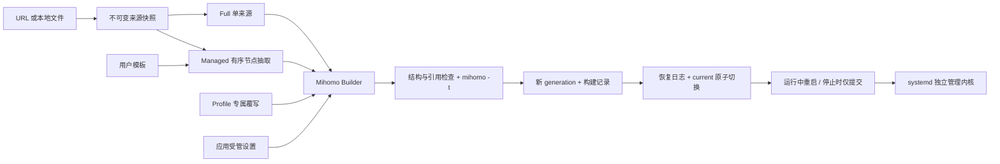

# 订阅与配置系统设计

状态：2026-10-29 已实现 Linux / systemd 用户服务 / Mihomo 路径。调研依据、固定提交源码和方案比较见 [竞品调研](subscription-research.md)，本次验证见 [验证记录](subscription-verification.md)。

## 选择与边界

采用“独立订阅来源 + Profile 配方 + 显式操作的 Builder + 不可变运行代”的方案。完整配置是默认产品路径；同时实现范围受限的 Managed Profile，供自行维护策略组、解析策略和规则的用户组合多个节点来源。两者共享下载、快照、校验、提交和失败恢复，使用不同的配置构建语义。

不把订阅限定为节点列表，也不把所有订阅都视作可直接启用的完整配置。来源先以 Mihomo YAML 保存；要求至少具有可识别的业务字段，拒绝明显的错误响应 mapping 和 sing-box 外核配置。Mihomo 自身对未知字段很宽容，单靠 `-t` 会把一些错误 JSON 当成无节点配置接受。具体哪些部分参与运行，由 Profile 的模式决定。多个完整配置各自的组名、引用和规则顺序没有普遍合理的自动合并结果，因此本版不提供“合并多个完整 YAML”功能，也不默认把用户数据发送到第三方订阅转换服务。

不新增常驻 daemon、脚本执行器、通用 Patch DSL、多内核中间表示或未使用的平台接口。现有原子存储、安装代际、systemd 归属校验、运行意图和恢复代码有实际价值，予以保留；旧的同名 raw/metadata/marker 多文件订阅提交被替换。

## 领域模型

| 概念 | 负责什么 | 不承担什么 |
| --- | --- | --- |
| Subscription | 名称、格式、可选私密来源地址、更新时间、当前已接受的内容摘要 | 不表示已选中，不保存用户规则，不决定运行模式 |
| Profile | 内核种类、full/managed、来源引用、Managed 模板、Profile 专属覆写 | 不拥有进程，不修改下载快照 |
| Application Settings | 受管回环端口、控制密钥、显式全局 mode；运行意图/自启动及界面偏好各自保存 | 不存订阅规则，不从订阅自动接管主机网络 |
| User Configuration | 作为 Profile 的 template/overrides 保存，具有独立于来源的生命周期 | 暂不引入额外全局 Mixin 实体；避免切源后组名失配 |
| Runtime Configuration | 已构建、经内核解析校验的完整 YAML 与构建依据，组成不可变 generation | 不是用户编辑入口；不是所有远程 provider 内容的版本快照 |
| Core Runtime State | systemd 状态/PID、认证 API、mode/节点观察；用户意图和操作记录独立持久化 | 不从磁盘摘要推断内核正在使用完全相同的配置 |

Subscription 与 Profile 是多对多引用关系的受限形式：Full 恰好引用一个来源；Managed 有序引用多个来源；多个 Profile 可复用同一来源并各有覆写。内建 `default` 不需要订阅。一次性导入也保存内容快照，但 Address 为空，不能假定原 URL/路径仍可用于刷新。



## 存储与版本

```text
HOME/
  configuration/
    library.json                 # 一个原子索引：来源、revision、Profile 配方及历史校验标记
    snapshots/<sha256>.yaml      # 下载原文，内容寻址、只新增、0600
  installation/
    mihomo
    generations/g-<id>/
      config.yaml                # 最终运行配置
      manifest.json              # 应用设置、配置/二进制摘要、配方与来源 revision
    current -> generations/g-<id>
    runtime/                     # 稳定的 Mihomo -d；选择缓存、隔离后的 HTTP providers、本地资产
  apply-pending.json             # 尚未提交的配置变更，含两代 guard
  runtime-state.json             # 用户 running/autostart 意图与操作状态
  stop-intent.json               # 独立的 Stop 优先记录
  preferences.json               # 非敏感偏好
```

快照先写，索引后写。来源 revision、Profile 引用及校验记录在一次索引替换中提交；中断最多留下未引用快照，不再出现旧实现“source.json 已更新、raw 未更新、以后只能手工重导入”的中间状态。应用锁序列化 CLI/TUI 操作，文件比较保护外部编辑；损坏索引或快照明确报错，不自动重置。

生成代保存所用配方和来源摘要，设置调整与 mode 调整继续使用已经应用的配置及这份构建记录，不意外采用刚刷新的订阅或未应用覆写。后续再次 Apply 才读取最新配方。启动与重启使用已提交 generation，来源网站不可用也不需要重新下载。

当前保留旧 generations 和来源快照，尚无自动 GC；删除来源/配方删除索引关系，不立即销毁历史原文。这样可以保留恢复和审计依据，但磁盘会增长，历史内容仍是敏感数据。未来 GC 必须同时考虑当前代、恢复日志、历史代的引用和明确保留策略。

本次不自动迁移早期 `profiles/*.yaml`、`.source.json`、`.unvalidated` 格式，也不静默删除这些文件。已有开发数据应先备份原始 YAML，再用导入命令建立新库；旧运行产物仍由服务生命周期代码管理。新增 `profile list` 输出安全详情对象，不再仅输出名称数组。

## 构建语义与字段所有权

构建顺序：解析单一 YAML mapping → Managed 可选节点抽取 → 执行 Profile 覆写 → 检查容器与命名 → Provider 缓存路径隔离 → 引用检查 → 最终强制应用受管设置 → 应用显式全局 mode → Mihomo `-t`。

| 内容 | 行为 |
| --- | --- |
| Full 基础 | 保留来源节点、策略组、规则、providers、hosts、解析策略及未知原生字段 |
| Managed 基础 | 用户模板；依声明顺序追加各来源的 inline proxies；不导入来源组、规则、hosts、DNS 或 providers |
| `overrides.set` | 明确的顶层字段整体替换；map、list 都不 Deep Merge，不按数组索引合并，不按 name 静默覆盖 |
| `prepend-rules` | 前插，保持输入顺序，重复规则保留 |
| `append-rules` | 后插；已有可确定终止的 MATCH,DIRECT/REJECT/REJECT-DROP 时拒绝，用户可替换规则列表或改为前插 |
| proxies / groups | 拒绝重复或保留名称；检查组的 proxies/use 引用、显式循环和节点 dialer-proxy 依赖 |
| 规则 | 简单规则检查目标和 RULE-SET 引用；逻辑表达式、sub-rules 等由 Mihomo 最终解释；不自行排序、去重或误判 MATCH,PASS 一类原生语义 |
| HTTP Provider | 根据类别、名称及除 path 外的完整定义确定缓存摘要；URL/header/behavior 变化会使用不同缓存，避免同名旧缓存串来源 |
| File Provider | 保留相对于稳定 runtime 目录的本地资产语义，拒绝绝对路径和上级目录穿越；本版不会随导入自动复制本地资产 |
| 控制接口/监听 | 应用最后指定回环 API + 密钥 + mixed-port，关闭订阅的其他入站、LAN、UI、DoH listener 等 |
| DNS | 保留 resolver 配置，只强制清空 dns.listen；不能通过覆写启用外部 DNS 监听 |
| TUN/路由/特权功能 | systemd 用户服务不支持；Full 的 TUN 请求明确报错，Managed 不消费的源 TUN 字段不影响节点抽取 |
| 节点选择 | 强制 Mihomo `profile.store-selected=true`，稳定 `-d` 保留选择缓存 |

受管字段出现在用户 `set` 中会被拒绝，避免用户以为覆写已生效。模式通过 `mode set` 改，不通过 Profile 覆写设置；订阅原有 mode 在没有应用显式 mode 时仍可作为基础值。null 不作为自定义删除语法；需要清空字段时显式使用空 list/map。原生来源中的空节点/规则容器允许为 null。

Managed 不是完整配置的无损转换。节点可能依赖来源 hosts、DNS 或 dialer-proxy；模板必须提供所需解析与引用。显式 dialer 依赖会检查，但真实域名解析/远程可达不能由构建器证明。只包含 proxy-providers 的来源不能被当成 inline 节点来源，明确拒绝；未来 provider 模式应另定义资源下载和快照责任。

HTTP provider 的顶层定义虽然固定，其内容仍可能由 Mihomo 自行刷新；顶层配置摘要不能表示所有节点/规则内容版本。Managed 的受控 inline 快照提供更强的输入可重现性。需要完全锁定 Full 的远程资源时，未来应把 provider 内容也纳入应用快照，不能只增加一个“已应用 SHA”。

## 校验、发布和失败恢复

所有应用都重新生成候选并运行当前已安装内核的 `-t`。候选位于 runtime 内的私有临时目录，`-d` 使用与服务相同的稳定 runtime，避免相对 provider、rule 与本地资产在校验和实际运行中含义不同。更新内核验证现有配置时同样使用此上下文。

本地结构校验不替代内核校验；安装前可保存通过结构/引用检查的配方，`validated=false`。安装、保存、刷新或应用时运行过内核校验的标记只是历史解析记录，Apply/Start 仍重新校验，不把它当网络可用承诺。

运行中 Apply 的事务：

1. 验证所属 unit，记录原状态/PID；生成与校验候选，保持旧运行代。
2. 写完整新代，再次检查状态/PID，防止准备期间外部停止或重启。
3. 写恢复日志，包含 old/new 两代的配置和文件树 guard；原子切换 current。
4. 若原本运行，则请求 systemd 重启，检查 owned service active、认证 API 和回环 mixed TCP 监听。
5. 成功后持久删除 journal，记录校验标记；失败或取消使用独立短时清理 context 恢复旧指针和原运行状态。保存的订阅/覆写草稿保留，供用户修复或重试。

本版配置加载采用受控重启，会中断当前连接。Mihomo 支持 PUT /configs，但源码显示 Parse 成功后 ApplyConfig 的若干子系统错误只写日志，GET /configs 又不能返回完整配置摘要。当前不引入第二套“HTTP 204 即提交”路径。将来做热加载时，需要统一现有发布 journal、部分失败和超时的不确定结果，不能简单替换一行 restart。

恢复失败会保留 journal 与两代，下一次共享应用用例首先重试恢复；检测到用户文件、二进制、unit 变化则保留并报错。显式 Stop 优先于恢复，不能因为回滚而把用户已停止的内核重新启动。服务仍由 systemd 管理，退出 TUI/关闭终端不发 Stop；运行中的普通操作取消会完成必要恢复。

磁盘切换与服务启动不可能跨进程原子提交。强杀控制进程或掉电发生在事务中间时，journal 表示未确认结果，下一次控制操作保守恢复旧代；当前没有额外 daemon 在无人操作时立即执行恢复。成功提交后的工作不依赖 TUI 存活。真实 SSH 最后会话退出和系统启动还依赖用户 manager 的 linger、自启动策略，见 [持久运行](runtime-lifecycle.md)。

就绪检查证明本地进程/API/监听可用，不能证明所有代理、远程 provider、DNS 或路由都成功。`Snapshot.Generation` 是应用提交的磁盘代标识，`ProfilePending` 表示当前配方与该代输入不同；它们都不是从内核读取的完整配置身份。外部 API 改动只能对已观察字段报告漂移，不声称能检测任意原生字段变化。

## 操作与状态变化

| 操作 | 持久化变化 | 是否生成/校验 | 对运行中内核的影响 |
| --- | --- | --- | --- |
| subscription add | 新来源、快照，无 Profile | 来源结构检查 | 无，不选择、不启动 |
| profile add/import | 同时新来源和 Full 配方；记源需明确选择 | 构建；已安装则 `-t` | 无 |
| profile create | 新配方，可复用来源 | 构建；已安装则 `-t` | 无 |
| refresh source / full profile | 先准备快照，所有引用它的配方通过后原子更新索引 | 检查所有依赖，已安装则 `-t` | 无；选中配方显示 pending |
| 保存覆写/规则 | 更新 Profile 覆写，来源不变 | 候选构建/校验后保存 | 无；需显式 Apply |
| Apply / 切换 Profile | 新代、构建记录和 applied 一起提交 | 始终重新构建及 `-t` | 原本运行才重启；失败恢复旧代 |
| 停止期间 Apply | 提交下一次启动使用的代 | 同上 | 保持停止 |
| 改端口 | 用当前已应用产物生成新代；设置与代同时提交 | 校验、端口冲突检查 | 原本运行则受控停止/重启；失败恢复 |
| 改 mode | 当前代和持久 mode 一起更新 | 校验，并验证 API 设置/readback | 使用既有 mode PATCH；失败按 journal 恢复 |
| 选择节点 | Mihomo 稳定目录中的选择缓存 | 通过认证 API 选择 | 即时生效，跨界面退出和重启保存 |
| 删除 Profile | 删除非选中配方；来源与历史快照保留 | 检查选中关系 | 无；选中者需先切换 |
| 删除 Subscription | 删除无引用来源的索引项 | 检查全部 Profile 引用 | 无；有引用就拒绝 |
| Start / Restart | 运行意图与操作状态持久化 | 验证已提交产物，不重新抓取来源 | systemd 执行，检查就绪 |
| Stop | 持久停止意图，必要时恢复文件 | 先验证 unit 所属 | 停止并阻止恢复隐式重新启动 |
| 退出 TUI / SSH | 不写停止意图、不删除运行数据 | 无 | 成功运行状态继续；SSH 注销要求 linger |
| 下载/构建/校验失败 | 原索引、配方和当前代不变；可能保留未引用私密 blob | 返回脱敏错误 | 无 |
| 已生成但加载失败 | 恢复旧代；保存的新来源/覆写仍为 pending | 恢复失败保留 journal | 尽力恢复此前运行状态，失败明确报告 |

无后台定时刷新。本版每次刷新一个来源；Managed 的多个来源不是一次远程下载事务，组合由明确的快照集合表示。输入暂限 Mihomo 配置/inline proxies 文档，不提供 URI/base64 订阅转换；订阅获取当前使用有界直连请求，安装下载页面的网络偏好尚未复用到订阅获取。任何一个依赖配方校验失败都会拒绝该次 source revision 更新；用户应先修复引用关系，而非让系统静默丢弃规则。

## 使用入口

```sh
# 完整订阅：便捷创建来源和同名配方；默认只保存，显式选择后才运行
lazyclash profile add airport https://example.invalid/sub --remember-source
lazyclash profile override airport /absolute/path/airport-overrides.yaml
lazyclash profile apply airport
lazyclash profile refresh airport
lazyclash profile show airport        # pending=true 时再次 Apply 才加载更新

# 同一来源可复用，Managed 仅使用其 inline proxies
lazyclash subscription add second /absolute/path/second.yaml
lazyclash profile create mine --managed --sources airport,second --template /absolute/path/template.yaml
lazyclash profile apply mine
lazyclash subscription list
lazyclash profile list
```

Managed 模板示例：

```yaml
proxy-groups:
  - name: PROXY
    type: select
    include-all-proxies: true
    proxies: [DIRECT, REJECT]
rules:
  - MATCH,PROXY
```

Profile 覆写示例（`set.dns` 整体替换，需写全期望的解析策略）：

```yaml
set:
  log-level: warning
  dns:
    enable: true
    nameserver: [https://dns.example.invalid/dns-query]
prepend-rules:
  - DOMAIN,blocked.example.invalid,REJECT
```

TUI Profiles 页支持一次性导入、明确记源订阅导入、应用、来源刷新、覆写文件导入和名称确认删除；显示待应用更改，不显示私密地址。Managed 模板/多源配方创建先通过 CLI；创建后可在同一 TUI 列表应用。两种界面调用同一个 app 用例，不分别执行 YAML 合并或内核生命周期逻辑。

## 扩展方向

来源库和内容寻址存储不依赖 Mihomo。未来新增 sing-box 时增加明确的 format/core 兼容判断及原生 Builder、校验/控制适配；不会把 Mihomo groups/rules 强行映射为一个假想通用格式。新 service/OS 适配继续接入应用生命周期边界，界面不操作 systemd。

后续优先级：订阅下载的显式代理/UA 策略；Linux 特权系统服务/TUN 的权限与网络副作用恢复；受 journal 保护的热加载与更多实际就绪观察；provider 内容快照/资产导入；可编辑 Managed 模板和来源组合的 TUI；带引用的 GC/历史回退命令；必要时由 systemd timer 调用共享刷新用例。自动刷新何时应用应是显式产品策略，不与“下载成功”绑定。
